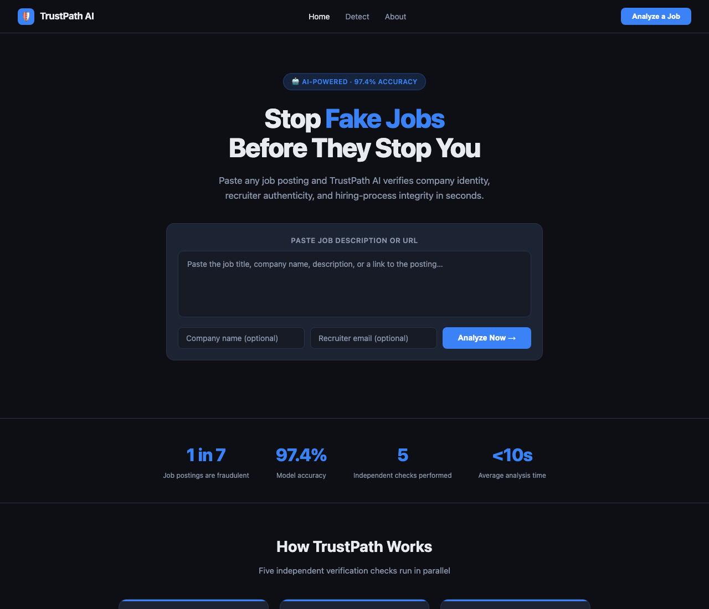

# TrustPath AI



Job fraud detection for job seekers. Paste a job posting and get a **Real / Suspicious / Fake** verdict, a confidence score, the signals behind it, and concrete next steps.

> **Status: early prototype.** The UI is a clickable demo with a mock keyword-based verdict. The backend is an API scaffold with no detection logic yet. See [Status and roadmap](#status-and-roadmap).

## Why

Roughly 1 in 7 online job postings is fraudulent (figure from the product copy; source not yet cited). Victims lose money (training fees, equipment deposits, overpayment cheques) and identity data (Aadhaar/PAN/SSN). Job platforms moderate their own listings, but scams migrate to WhatsApp, Telegram and personal email, and impersonate real companies, so the candidate is the last line of defence.

## Key idea: verify five things independently

A real company can have a fake posting that impersonates it, so checking the company alone is not enough. TrustPath scores five dimensions separately:

| # | Check | What it looks at |
|---|-------|------------------|
| 1 | Company identity | Domain intelligence, business registration, official website corroboration |
| 2 | Job posting integrity | Unrealistic salary, vague duties, urgency, payment requests disguised as onboarding |
| 3 | Recruiter verification | Recruiter vs. LinkedIn, company directories, official career-page listings |
| 4 | Communication channel | Off-platform chats, Gmail/Yahoo contacts, WhatsApp-only hiring, suspicious links |
| 5 | Hiring process | Upfront fees, equipment deposits, overpayment, early requests for sensitive documents |

## Fraud patterns addressed

| ID | Pattern | Planned detection |
|----|---------|-------------------|
| PS-01 | Fake company creation | Existence verification, domain intelligence, independent source corroboration |
| PS-02 | Genuine company impersonation | Compare official domains, recruiter identity, contacts and career-page listings |
| PS-03 | Lookalike domains (`careers-stripe.com`) | Domain similarity scoring, WHOIS age, SSL validation, typosquatting detection |
| PS-04 | Payment and deposit scams | NLP scan for payment language and urgency triggers |
| PS-05 | Off-platform communication | Channel analysis, cross-platform recruiter matching |
| PS-06 | Overpayment and data theft | Hiring-sequence analysis, sensitive-data request detection |

## Status and roadmap

| Area | State |
|------|-------|
| Frontend UI (home, detect, about, result views) | Working prototype, single static file |
| Verdict logic | **Mock.** Keyword match (`whatsapp`, `telegram`, `deposit`, `training fee`, ...) plus source channel; confidence is random within a band |
| Backend API | Scaffold only: health endpoint, placeholder in-memory CRUD, tests |
| Five checks (WHOIS, registry, LinkedIn, NLP) | Not implemented |
| Frontend to backend integration | Not done |
| Persistence, auth, rate limiting | Not started |

The "97.4% accuracy" and "<10s" figures in the UI are placeholders, not measurements. Do not quote them externally until a labelled evaluation set backs them.

Suggested next steps:
1. Define a `POST /api/v1/analyze` contract (input: description/URL, company, recruiter email; output: verdict, score, per-check results, signals, next steps).
2. Implement the cheapest high-signal checks first: payment/urgency language, free-email recruiter domain, off-platform channel, domain age and lookalike detection.
3. Build a labelled dataset and an evaluation harness before adding model-based scoring.
4. Wire the frontend to the API and remove the mock.

## Architecture

```
index.html  (static UI, mock scoring in JS)
     |  not connected yet
     v
backend/    FastAPI app
  app/main.py            app factory, CORS
  app/api/router.py      mounts routes under /api/v1
  app/api/routes/        health, items (placeholder)
  app/schemas/           Pydantic models
  app/core/config.py     env-driven settings
  tests/                 pytest + FastAPI TestClient
```

## Getting started

Frontend: open `index.html` in a browser. No build step.

Backend (Python, FastAPI):

```bash
cd backend
python -m venv .venv && source .venv/bin/activate
pip install -r requirements.txt
cp .env.example .env
uvicorn app.main:app --reload     # http://localhost:8000/docs
pytest
```

### API

| Method | Path | Notes |
|--------|------|-------|
| GET | `/` | Welcome message |
| GET | `/api/v1/health` | Status, version, environment |
| GET, POST | `/api/v1/items` | Placeholder CRUD, in-memory, to be removed |
| GET, DELETE | `/api/v1/items/{id}` | Same |

### Configuration (`backend/.env`)

`PROJECT_NAME`, `ENVIRONMENT`, `DEBUG`, `API_V1_PREFIX`, `CORS_ORIGINS`.

## Limitations and risks

- A verdict is a risk signal, not proof. False positives can unfairly flag real employers; false negatives can give false comfort. The UI carries a disclaimer and the product should keep it.
- Checks that call third parties (WHOIS, registries, LinkedIn) have cost, rate limit and terms-of-service implications; LinkedIn in particular restricts scraping.
- Pasted job text and recruiter emails are personal data. Define retention and logging policy before any hosted deployment.
